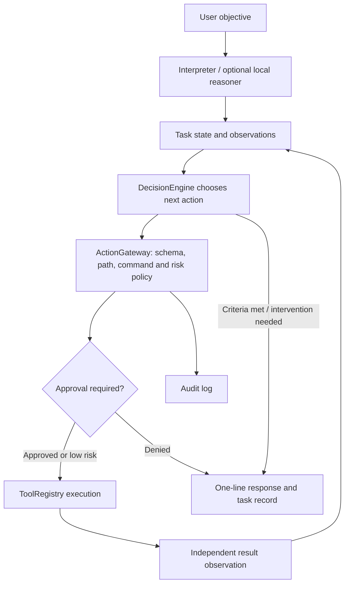

# MONDAY V2

A lightweight, local PC decision engine, built separately from `~/Projects/Monday`.
It observes the machine, chooses the next structured tool action, asks when required,
executes through one gateway, verifies results, and keeps an explainable task record.
Normal responses are one line. Unsupported or unverified outcomes stay incomplete.

Greetings and identity questions (including `hi, who are you?`) are handled locally without
web searches or tool execution. The REPL and pet remember their last task for `what does that
mean?`, `explain more` and `why did it fail?`. Evidence follow-ups reuse verified sources only;
unavailable/unsupported local synthesis yields a labelled PARTIAL excerpt. Context lasts for the
current REPL/pet session; separate CLI invocations do not silently inherit task history.
An ambiguous `do it`, `yes` or `open it` cannot supply an action target or permission. Unknown
model tool proposals require an explicit concrete request before execution.

## Start

The isolated environment and editable CLI are already set up on this machine:

```bash
cd /home/blu/Projects/MondayV2
source .venv/bin/activate
monday "check my ram"
monday "my computer is slow"
monday plan "restart bluetooth"
monday
monday run "hi, who are you?"
monday "list windows"
monday "focus window Firefox"
monday "close window Firefox"  # asks for approval; ambiguous titles are not guessed
```

Without activation, use `/home/blu/Projects/MondayV2/monday-launch "check my ram"`.
This launcher selects V2 without replacing the old MONDAY command.
The launcher resolves its own location, so it also works from another checkout or through a symlink.

Other commands: `monday explain`, `status`, `history`, `tools`, `doctor`, `config`,
`undo`, `stop`, `resume`. `run "objective"` also works. `--json` shows internal records.
`plan` and `--dry-run` show a conditional workflow and its next action without executing
it; later arguments depend on observations and are deliberately unresolved.
An approval on a noninteractive input is denied; only `y` or `yes` in a terminal approves.

## Architecture



A `Decision` contains the objective, observed state, action/tool/arguments, reason,
expected observation, risk, optional confidence and completion criteria.
Domain workflows describe evidence dependencies, not a precomputed command list:
slow-PC diagnosis needs CPU, RAM/load, disk and processes; process termination needs
an observed PID identity; a project needs location/build type before an approved build;
research needs search followed by page retrieval for each subject.
Each iteration sees actual observations. Failure, refusal, cancellation, repeated actions,
a step budget, or a time budget ends the loop honestly.

The model interfaces are optional advice. The gateway determines risk itself and never
uses confidence for authorization. Basic PC diagnostics and structured tools need no model.
`monday tools` exports the tools' JSON schemas. New tools register a schema, risk, executor
and, for mutations, a verifier; package operations also supply an approval preview.

## Tools

52 tools are implemented; see [the complete schema catalog](docs/tools.json).

| Group | Operations |
|---|---|
| System | CPU/load, RAM, disk, GPU, sensors, battery, uptime, network interfaces, PipeWire, rfkill, user warning logs |
| Processes/services | Search/rank by RSS, inspect, approved graceful user-process termination, service state, approved restart |
| Files | List/search/inspect/storage/read, create/write/copy/move/rename/delete, guarded recorded inverses |
| Applications | Discover XDG desktop entries, launch, open file in app |
| Desktop | Capabilities, supported window inventory/focus/close, XDG file handoff, Wayland clipboard, notification request |
| Commands | Exact diagnostic argv templates: uname, uptime, df, free, ip, rfkill |
| Packages | Arch installed/repository inspection; approved previewed install/remove/upgrade |
| Projects | Locate, identify Python/Node/Rust/Make/CMake, Git status/diff, approved build/test, editor and terminal launch |
| Web | Search, HTTP extraction with source records, browser handoff |

The concise grammar covers common diagnostic, application, service, process, project,
package and information objectives. Other operations are available without natural-language
ambiguity using explicit structured actions:

```bash
monday 'tool fs.list {"path":"/home/blu/Projects/MondayV2"}'
monday 'tool fs.search {"path":"/home/blu/Projects","pattern":"greenhouse"}'
monday 'tool fs.create {"path":"/home/blu/Documents/note.txt","content":"hello"}'
monday 'tool fs.copy {"source":"/home/blu/Documents/note.txt","destination":"/home/blu/Documents/note-copy.txt"}'
monday 'tool project.git {"path":"/home/blu/Projects/Greenhouse","operation":"diff_content"}'
monday 'tool project.run {"path":"/home/blu/Projects/Greenhouse","operation":"test"}'
monday 'tool web.read {"url":"https://example.com"}'
monday "get greenhouse ready"
monday "why isn't greenhouse building?"
```

Paths and project names must exist and match your machine. Filesystem changes ask first.
The agent never edits code in response to a build failure; a source write must be explicitly
requested and approved. Git helper execution is disabled for read operations. Builds/tests
execute repository code and always require approval, even when presented as diagnosis.

## Safety and verification

| Risk | Policy |
|---|---|
| READ_ONLY | Execute validated observation |
| LOW | Validated launch/focus/request |
| MEDIUM | Explicit approval: file writes/moves, app close, process termination, clipboard write |
| HIGH | Explicit approval: build/test code, service restart, previewed package transactions |
| CRITICAL | Explicit approval: file deletion; protected/outside paths remain blocked |

All engine actions pass through `ActionGateway`. Unknown tools, extra arguments, invalid
paths and unapproved command templates fail closed. Default filesystem roots are Projects,
Documents and Downloads; credential/configuration/generated directories and every symlink
component are blocked. Root-directory mutations are blocked. Copy/move accept regular files
up to 64 MiB; deletion supports files and empty directories only. No recursive delete.
These checks are policy protections for a trusted local user, **not an OS sandbox against
another process racing filesystem paths**. Do not run the agent on attacker-controlled trees.

Command execution always uses argv and `shell=False`, captures stdout/stderr/exit status,
limits output, enforces timeouts, checks stop signals and kills command descendants.
`Ctrl-C` stops the active task; `monday stop` creates a persistent stop flag checked by
other running instances. `monday resume` explicitly clears it. An approval wait must return
before a stop flag can be observed; it still cannot execute the pending action afterward.

MONDAY refuses to run as root. Service/package privilege is requested per operation through
`pkexec`; passwords are never stored. Package resolver output is displayed before approval,
rechecked before execution and installed versions/removal are observed afterward. Only after
this approval does pacman receive `--noconfirm`. Upgrades use the **current pacman databases**;
V2 does not refresh them or manage AUR operations. Transaction changes abort for renewed approval.

Filesystem writes check resulting hashes against expected data; moves check source absence.
Undo exists for newly created/copied unchanged files, still-empty created directories, and
unchanged moved files whose former path remains free. Modified files refuse undo. Overwrite,
delete, package operations, launches and service changes have no claimed inverse.

Applications are verified by a matching live process. This does not prove a window is visible
or a project has finished loading. Browser and XDG file handoffs explicitly return PARTIAL
because there is no observation API for the user's browser. Notifications verify delivery to
the notification command, not that the user saw them. Unsupported APIs return errors.

Task records and the append-only JSONL action log live in `~/.local/state/monday-v2/` with
private permissions. They record proposals, decisions, approvals, results and verification.
Secret patterns are redacted; supplied file bodies, clipboard contents and read responses are
omitted from persisted tasks. Redaction cannot identify arbitrary secrets in other tool output;
consider the task history private. `explain` reads the last detailed task record.

## Web and optional models

`WebSearch`, `Browser`, `PageExtractor` and `EvidenceStore` are separate components. HTTP
retrieval avoids starting a browser, bounds content/time, validates redirects and restricts
non-public destinations. Public HTTP(S) services may use any valid port. Search snippets never count as page evidence. General web search is enabled by default through DuckDuckGo Lite, with no API key or
extra service. If it is blocked or unavailable, Wikipedia OpenSearch is an explicitly
labelled limited fallback. An explicitly configured SearXNG JSON endpoint takes precedence.
Search queries are sent to the selected provider; no search service is installed locally.

```bash
monday "search web for Python official documentation"
monday 'tool web.read {"url":"https://docs.python.org/3/"}'
# Optional provider overrides:
export MONDAY_SEARCH_PROVIDER=duckduckgo  # fail explicitly if general search is blocked
export MONDAY_SEARCH_PROVIDER=wikipedia  # restrict search to Wikipedia
export MONDAY_SEARXNG_URL=http://127.0.0.1:8888
```

Web content is untrusted. Obvious instruction paragraphs are excluded; the architectural
boundary is stronger than that filter: webpage data never goes to local tool interpretation.
Research chooses only search/read actions. A summarizer receives evidence through an
output-only interface and cannot execute tools. Without a successful model summary, the
response contains labelled source excerpts and returns PARTIAL. Lexical checks on model
citations/quotes are conservative and are not semantic proof; generated summaries also stay
PARTIAL. Ordinary questions use the local language model without tools; answers are labelled as not externally verified. Explicit search/documentation requests retain the evidence path.

Ollama defaults to an **already installed** `gemma3:1b` at `http://127.0.0.1:11434`:

```bash
monday "Explain recursion"
MONDAY_MODEL=gemma3:1b monday "Explain my RAM usage"
# Set MONDAY_MODEL= to disable local inference; MONDAY never downloads weights.
```

It checks `/api/tags`, never pulls a model, caps context/output, and requests immediate
unload (`keep_alive: 0`). Network/model/malformed-output failures fall back. Natural-language
proposals still face the normal gateway and approvals.

Laya is opt-in behind `DecisionProvider`: it selects execute/clarify for typed action candidates and chooses bounded research candidates. It never generates prose or grants execution permission. Without a local checkpoint, deterministic recipes remain available.
Set `MONDAY_LAYA_PATH` to a **complete local checkpoint directory** and install the optional
Python dependency separately if wanted. The worker sets Hugging Face/Transformers offline,
uses `laya.load(local_path)` and `Agent.predict`, validates the selected candidate, runs in a
killable timed subprocess, and releases model RAM when finished. It never uses `Router`,
which can download checkpoints on first use. Confidence never grants permission. This
implementation trades repeated load latency for bounded memory and reliable cancellation.
Ollama transport is restricted to loopback, ignores environment HTTP proxies and refuses redirects.
No live Laya or Gemma inference was available in the cloud validation environment.
See [local language and desktop gateway](docs/LOCAL_COMPANION.md) for architecture, configuration, verification and limitations.

## Web access and restored desktop commands

Clear desktop commands no longer wait for Gemma to restate identical arguments. General
questions use plain local chat, with automatic cited web lookup if the answer is unusable;
current questions and explicit URLs go directly to research. Public HTTP(S) access is enabled
across domains. Use `MONDAY_WEB_FALLBACK=0` to disable automatic fallback.

Try `open visual studio`, `open youtube`, `move window Code to workspace 2`,
`float window Code`, or `resize window Code to 1000x700`. `set clipboard to "a note"`
previews a clipboard write for approval. Native layout results require compositor read-back;
browser handoffs do not claim verified navigation.

See [web and desktop repair](docs/WEB_DESKTOP_REPAIR.md) for exact scope, evidence and
limitations. General in-app clicking/typing is not implemented by these native window APIs.

## Tests and measurements

```bash
cd /home/blu/Projects/MondayV2
.venv/bin/python -m pytest -q
.venv/bin/python scripts/live_checks.py
.venv/bin/python scripts/benchmark.py
```

See [BUILD_REPORT.md](docs/BUILD_REPORT.md) for results, live checks, old-code decisions,
measurements, limits and the exact created-file inventory.
For a separate machine: `python -m venv .venv`, activate it, and explicitly install
`pip install -e '.[test]'`. The supplied environment on this machine uses existing system
site packages to avoid downloading models or duplicating heavyweight dependencies.

## Desktop pet

Run `monday pet on` for the native circular companion with a command box above it.
`monday pet off` closes it; `monday pet status` checks whether it is running. Click the
pet to toggle the box and drag its header to move it. It offers sustained resource-pressure
hints and keeps normal approvals for risky actions. See [PET.md](docs/PET.md) for controls,
new command examples, GPU telemetry and measured resource use.

On Hyprland, the pet uses `hyprctl` for its own observed QML process/window only: floating,
pinning across workspaces, scaled monitor placement, and resizing while keeping the bot's lower
right corner stable. The collapsed window shrinks to the bot, rather than leaving a wide transparent
input surface. No compositor configuration or global window rules are edited. `monday pet status`
reports placement failures honestly. See [the V2 fix report](docs/CONVERSATION_HYPRLAND.md) for
cloud test coverage, the two environment skips and the remaining need for a real Hyprland/Qt smoke test.

The companion now uses a compact normal window with fixed, content-derived size constraints.
Compositor-assigned tile dimensions never feed back into its requested geometry. A periodic scoped
check restores floating geometry if Hyprland re-tiles it, while preserving intentional dragging.
The pet has distinct idle, attentive, curious, thinking, success, approval, warning, error and offline
expressions. Results are selectable and scrollable. See [the window follow-up report](docs/PET_WINDOW_FIX.md).

Optional **developer-only** real Qt integration (not required to run the existing QML frontend):
`pip install -e '.[test-ui]'`, then `python -m pytest -q tests/test_pet_window.py`.
